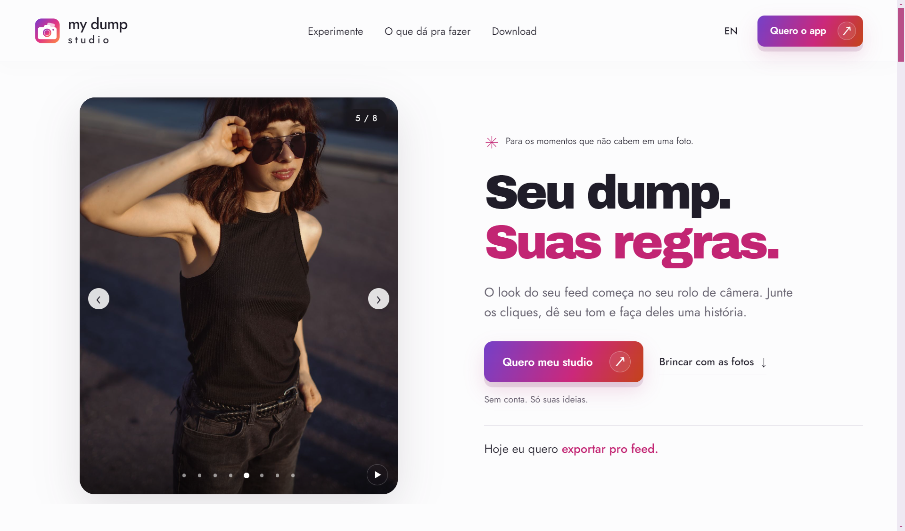

# My Dump Studio

Versão atual: **1.0.0 — Cherry Pie Version**. A distribuição fica em
`dist/1.0.0 - Cherry Pie Version/`, com o nome da edição na splash, no Sobre e no instalador.

## Site e demonstração

O site do **My Dump Studio** fica em [`.site/`](.site/README.md), com fotos licenciadas,
hero arrastável, mini editor com o motor real de filtros, exportação PNG, comparador
antes/depois e idiomas português/inglês. O download detecta o último instalador de uma
release pública do GitHub. Enquanto não houver release, a página informa **Em breve**.

Para abrir localmente, na raiz do projeto:

```powershell
python -m http.server 4173 --directory .site --bind 127.0.0.1
```

Acesse `http://127.0.0.1:4173` ou o [site público no GitHub Pages](https://felipeaguiarcode.github.io/dump-studio/).
O branch `site` contém a versão publicada, com deploy automático pelo GitHub Actions.
As instruções estão em [`.site/README.md`](.site/README.md).



### Capturas reais do editor

As capturas abaixo foram feitas com um projeto temporário e fotos licenciadas de exemplo.


Editor desktop minimalista para criação de **photo dumps** em preto e branco (estética noir) para Instagram. Local-first, com persistência completa em SQLite e autosave confiável.

> Aplicação construída a partir da especificação em [`prompt.md`](./prompt.md).

O aplicativo não possui prazo de expiração nem bloqueio por licença.

A splash e a tela **Sobre** exibem **Created by Felipe Aguiar**, com links para
[GitHub](https://github.com/felipeAguiarCode) e
[LinkedIn](https://www.linkedin.com/in/felipeaguiar-exe/). O Sobre pode ser aberto pelo
ícone de informação da tela inicial ou em **Preferências → Sobre**. Os links abrem
no navegador padrão.

A interface **White** é o padrão: superfícies brancas, área de edição em cinza claro
e destaques rosa, roxo e laranja inspirados no Instagram. O tema **Noir** continua
disponível pelo botão de lua/sol ou em Preferências → Aparência. A escolha é salva
e vale também para a splash e as janelas nativas, sem alterar as cores dos projetos.

O ícone do app e do instalador usa um monograma N em prata sobre uma base escura.
A splash nativa exibe a arte de filme fotográfico por pelo menos cinco segundos e fecha
quando a janela principal está pronta. Ela acompanha o idioma do sistema (português
ou inglês), respeita movimento reduzido e funciona offline.

Os originais da identidade visual e os prompts ficam em `assets/branding/`.
`npm run build:branding` prepara o ICO multirresolução, o ícone PNG e a arte WebP;
esse passo roda automaticamente no desenvolvimento e nos builds.

Dentro do editor, o controle **Formato**, disponível apenas na barra superior, permite
alternar entre quadrado, retrato, horizontal, ultrapanorâmico, feed e Stories/Reels.
A mudança vale para todas as páginas, preserva as proporções e os recortes existentes e
usa o fundo do canvas nas margens. As edições pendentes são salvas antes da troca;
Ctrl+Z restaura o formato e a composição anteriores.

Em **Texturas**, a seção **Aberrações Cromáticas** reúne os efeitos antes chamados
Games. Em **Filtros**, **Editorial** inclui Porcelana, Cetim, Grafite e Champagne;
**Laboratório** inclui Cianotipia, Selênio, Lith e Solarização. Todos têm intensidade
ajustável e usam o mesmo motor na prévia e na exportação, apenas na foto selecionada.

O botão **Presets** no menu esquerdo abre uma biblioteca compartilhada entre projetos,
com busca, pastas e subpastas. **Salvar preset** captura os ajustes, curvas, cores,
filtro, câmera, texturas, borda e opacidade da foto; o diálogo permite escolher os FX.
Os FX novos adicionados sobre uma foto ficam vinculados a ela. Ao reaplicar um preset,
os FX vinculados são substituídos e adaptados ao tamanho da foto, sem duplicação.
Recorte, posição, foto original, textos e layout de destino são preservados.

Um clique aplica o preset, e Ctrl+Z desfaz a operação completa. **Copiar look** e
**Colar look** usam Ctrl+Shift+C / Ctrl+Shift+V; Ctrl+C / Ctrl+V continuam copiando camadas.
O menu de cada preset permite renomear, mover, copiar, excluir e exportar JSON.
Na biblioteca, **Exportar JSON** exporta a pasta selecionada com as subpastas, ou a
biblioteca inteira em **Todos os presets**. A importação de JSON e da área de transferência
mantém os presets existentes e cria cópias com nomes distintos. O JSON é próprio do Noir
e contém configurações, sem fotos ou caminhos dos arquivos originais.

## Stack

- **Electron** + **electron-vite** (main / preload / renderer)
- **React** + **TypeScript** + **Vite**
- **better-sqlite3** (persistência local em `userData`, migrations versionadas)
- **Zustand** + **immer** (estado do editor, undo/redo)
- **Konva** / **react-konva** (composição do canvas)
- **regl** / WebGL2 (pipeline de processamento de imagem por camada)
- **sharp** (thumbnails e metadados de imagem)
- **Tailwind CSS** (tokens noir)

## Desenvolvimento

```bash
npm install     # instala deps e recompila módulos nativos para o Electron
npm run dev     # abre o app em modo desenvolvimento (HMR)
npm run typecheck
npm run build   # build de produção
npm run dist    # empacota instalador Windows (nsis)
npm run check:startup # testa a abertura da Cherry Pie Version com dados temporários
npm run check:formats # verifica proporções, layouts, trocas repetidas e a barreira de autosave
npm run check:filters # compila o shader e verifica os 44 filtros em um WebGL real do Electron
npm run check:themes # verifica migração, persistência, alternância e contraste dos dois temas após build
npm run check:presets # verifica biblioteca, pastas, JSON, FX, copiar/colar e undo no editor real após build
```

Distribua o instalador gerado ou a pasta `win-unpacked` inteira. O executável isolado
não contém os módulos nativos necessários em `resources/app.asar.unpacked`.

### Pré-requisitos no Windows

Os módulos nativos (`better-sqlite3`, `sharp`) são recompilados para a ABI do Electron
no `postinstall` (`electron-builder install-app-deps`). Se a recompilação falhar, instale
o **Visual Studio Build Tools** com o workload *"Desktop development with C++"*:

```powershell
winget install Microsoft.VisualStudio.2022.BuildTools
```

E rode novamente: `npm run rebuild`.

## Arquitetura

```
src/
  shared/     tipos e contrato IPC compartilhados (sem electron/node/DOM)
  main/       processo Electron: DB, repositories, services, IPC, filesystem
  preload/    bridge contextIsolation → window.noir (tipado)
  renderer/   UI React (features, stores Zustand, services)
  engine/     motor de imagem: compositor Konva + pipeline WebGL + export
```

**Regra crítica:** ajustes e filtros fotográficos são aplicados **somente à camada de
imagem selecionada**, nunca globalmente no canvas. O canvas só tem propriedades
estruturais (formato, background, guias, grid, bordas).

## Ganchos de desenvolvimento (gated por variáveis de ambiente)

Úteis para testes/screenshots; nenhum efeito em produção:

- `NOIR_SEED=<pasta>` — se o banco estiver vazio, cria um projeto e importa as imagens da pasta.
- `NOIR_SHOT=<arquivo.png>` — captura a janela após o carregamento e encerra o app.
- `NOIR_SPLASH_SHOT=<arquivo.png>` — captura a splash de abertura sem interromper a inicialização.
- `NOIR_EXPORT=<pasta>` — auto-exporta o dump aberto para a pasta (verificação de exportação).
- `NOIR_DIALOG=preferences|snapshots|export|about` — abre o diálogo no boot.

> Módulos nativos são compilados para a ABI do Electron — scripts Node avulsos não
> conseguem carregar `better-sqlite3` (apenas o app Electron). `sharp` (N-API) carrega em ambos.
