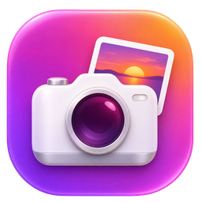
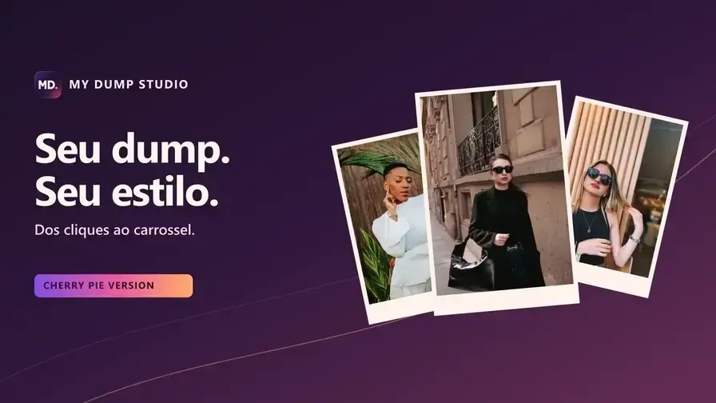
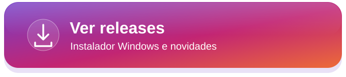
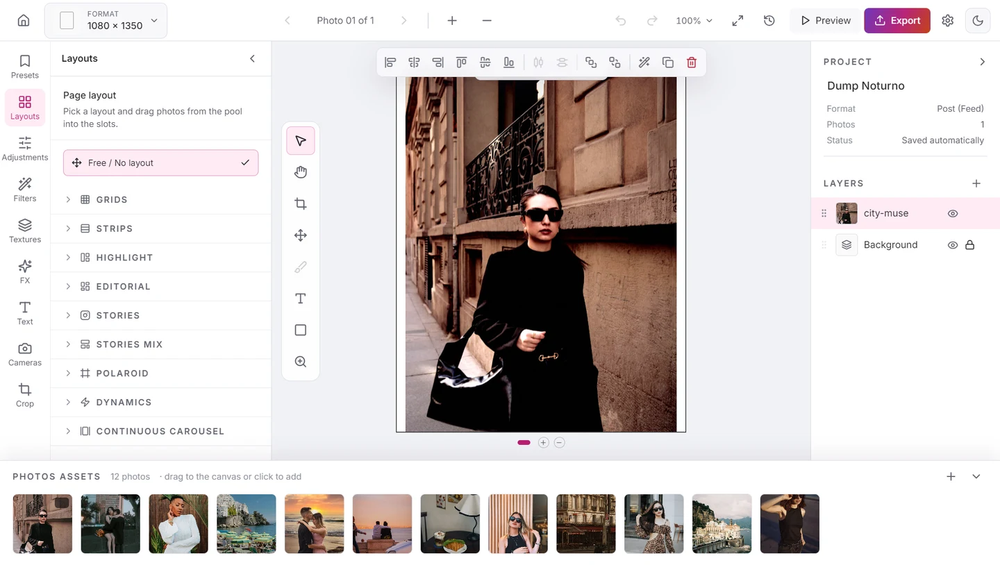

<p align="center">
  
</p>

<h1 align="center">My Dump Studio</h1>

<p align="center"><strong>Seu dump. Seu estilo. Seu olhar.</strong></p>
<p align="center">Transforme fotos soltas em uma história sua.<br>Um editor desktop para criar photo dumps, encontrar seu look e montar carrosséis.</p>

[](.demo/videos/my-dump-studio-demo-youtube.mp4)

[**Assista à demonstração completa em 50 segundos**](.demo/videos/my-dump-studio-demo-youtube.mp4) · [Versão vertical para Reels](.demo/videos/my-dump-studio-demo-instagram.mp4) · [Créditos](.demo/CREDITOS.md)

<p align="center"><strong>1.0.0 · Cherry Pie Version</strong><br>Windows · Português e inglês · Projetos locais · Sem prazo de expiração</p>

<p align="center">
  <a href="https://github.com/felipeAguiarCode/dump-studio/releases"></a>
</p>
<p align="center"><a href="https://felipeaguiarcode.github.io/dump-studio/">Experimente a demo no navegador</a> · <a href="https://github.com/felipeAguiarCode/dump-studio/issues">Reporte um problema</a></p>

> O instalador será disponibilizado na aba **Releases**. Enquanto a primeira release pública não estiver disponível, você pode experimentar a demo ou executar o projeto a partir do código-fonte.

## Um studio para o seu próximo dump

Um date. Um café. Um look que deu certo. Junte os cliques, escolha a composição e dê às suas fotos um tratamento com a sua cara.


## O que você pode criar

| Seu processo | No studio |
| --- | --- |
| **Monte a história** | Colagens, grades, Polaroids, Stories e carrosséis contínuos. |
| **Encontre seu tom** | 44 filtros, simulações de câmera, curvas, ajustes de cor, texturas e FX. |
| **Guarde o seu look** | Presets compartilhados entre projetos, pastas, subpastas, favoritos e importação/exportação em JSON. |
| **Edite com liberdade** | Fotos, textos, formas, bordas e efeitos em camadas, com desfazer e refazer. |
| **Troque o formato** | Quadrado, retrato, horizontal, feed e Stories, preservando as proporções do conteúdo. |
| **Exporte para o feed** | Páginas em JPG ou PNG, nas dimensões do projeto. |

Os ajustes de imagem são aplicados à foto selecionada. Você mantém o controle de cada camada e pode voltar atrás sem alterar o arquivo original.

## Encontrou seu tom? Guarda.

Salve ajustes, filtros, câmera, texturas e FX como um preset. Organize seus looks em pastas, marque os favoritos e leve um preset ou uma coleção inteira para outra instalação em JSON.

**Salvar preset**, **Importar JSON** e **Exportar JSON** ficam acessíveis nos painéis de edição. Para repetir um visual rapidamente, use **Copiar look** e **Colar look**.

No menu **Presets**, expanda as pastas na biblioteca ou filtre pelos favoritos. Passe o mouse sobre um preset para ver o look na foto selecionada e clique no olho para abrir o **Antes/Depois** ou o **Showcase**. A prévia usa a foto do projeto ou uma foto de exemplo quando não há seleção.


## Cada clique encontra seu lugar

Escolha um layout, adicione suas fotos e ajuste cada elemento. O controle **Formato**, no topo do editor, atualiza todas as páginas do projeto e preserva as proporções do conteúdo, usando o fundo nas margens quando necessário.



## O seu processo é seu

- **Edição local:** projetos salvos no computador, com salvamento automático.
- **Sem conta:** abra o aplicativo e comece a criar.
- **Sem licença de 60 dias:** esta edição não tem prazo de expiração.
- **White ou Noir:** interface clara por padrão e tema escuro nas preferências.
- **Português e inglês:** escolha o idioma da interface.

## Experimente antes de instalar

No [site do My Dump Studio](https://felipeaguiarcode.github.io/dump-studio/), você pode experimentar fotos de exemplo, trocar looks e intensidade, comparar antes e depois, explorar layouts e baixar uma prévia em PNG. A demo usa o motor real de filtros e a geometria de layouts do aplicativo.

[](https://felipeaguiarcode.github.io/dump-studio/)

## Instalação e código-fonte

O aplicativo desktop é para **Windows**. Quando disponível, baixe e execute o instalador `.exe` na [aba Releases](https://github.com/felipeAguiarCode/dump-studio/releases).

O instalador desta edição se chama **My-Dump-Studio-1.0.0-Cherry-Pie-Version-setup.exe**. Ele cria o atalho **My Dump Studio** no Windows e abre o editor pela nova splash da Cherry Pie Version.

Para rodar a partir do código-fonte, com Node.js e npm instalados:

```powershell
git clone https://github.com/felipeAguiarCode/dump-studio.git
cd dump-studio
npm install
npm run dev
```

Para servir apenas o site localmente:

```powershell
npm run site
```

Abra **http://127.0.0.1:4173/**. A demo precisa de um servidor HTTP; abrir o HTML por duplo clique não carrega os módulos corretamente.

Consulte o [guia de desenvolvimento](docs/DEVELOPMENT.md) para build, testes, módulos nativos e arquitetura, ou o [guia do site](.site/README.md) para a demonstração e publicação no GitHub Pages.

## Criado por Felipe Aguiar

[GitHub](https://github.com/felipeAguiarCode) · [LinkedIn](https://www.linkedin.com/in/felipeaguiar-exe/)

As capturas usam projetos temporários e fotos de exemplo. Autores, fontes e licenças estão nos [créditos das fotografias](.site/assets/photo-credits.json). As pessoas retratadas não representam depoimentos ou endosso ao aplicativo.
