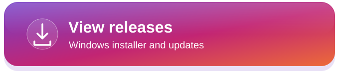
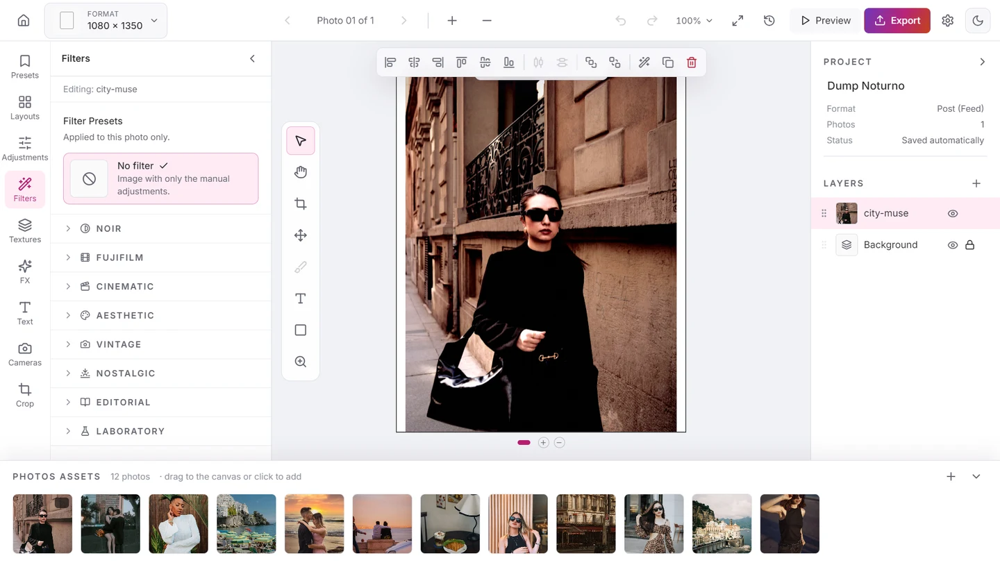
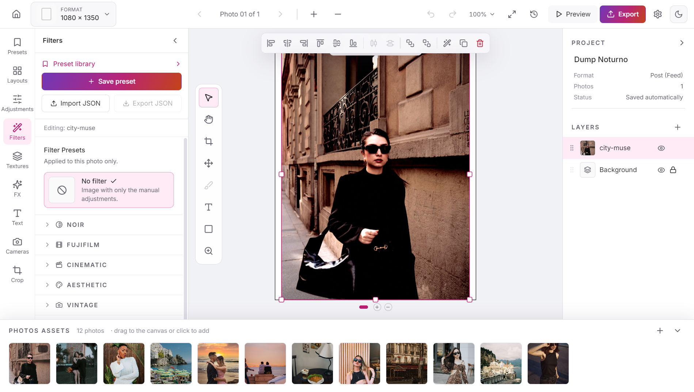

<p align="center"><strong>English</strong> · <a href="./README.pt-BR.md">Português (Brasil)</a></p>

<p align="center">
  
</p>

<h1 align="center">My Dump Studio</h1>

<p align="center"><strong>Your dump. Your style. Your point of view.</strong></p>
<p align="center">Turn everyday photos into a story of your own.<br>A desktop editor for creating photo dumps, finding your look, and building carousels.</p>

[](.demo/videos/my-dump-studio-demo-youtube.mp4)

[**Watch the full 50-second demo**](.demo/videos/my-dump-studio-demo-youtube.mp4) · [Vertical version for Reels](.demo/videos/my-dump-studio-demo-instagram.mp4) · [Credits](.demo/CREDITOS.md)

<p align="center"><strong>1.0.0 · Cherry Pie Version</strong><br>Windows · English and Brazilian Portuguese · Local projects · Full access with no expiration</p>

<p align="center">
  <a href="https://github.com/felipeAguiarCode/dump-studio/releases"></a>
</p>
<p align="center"><a href="https://felipeaguiarcode.github.io/dump-studio/?lang=en">Try the browser demo</a> · <a href="https://github.com/felipeAguiarCode/dump-studio/issues">Report an issue</a></p>

> The Windows installer will be available under **Releases**. In the meantime, try the browser demo or run the app from source.

## A studio for your next dump

A date. A coffee. An outfit that came together. Gather your photos, choose a layout, and give them a look of your own.



## What you can create

| What you want to do | Tools in the studio |
| --- | --- |
| **Build a story** | Collages, grids, Polaroids, Stories, and seamless carousels. |
| **Find your look** | 44 filters, camera simulations, curves, color adjustments, textures, and FX. |
| **Keep your favorite looks** | A preset library shared across projects, with folders, subfolders, favorites, and JSON import and export. |
| **Edit in layers** | Photos, text, shapes, borders, and effects, with undo and redo. |
| **Switch formats** | Square, portrait, landscape, feed, and Stories formats that preserve the proportions of your content. |
| **Export for your feed** | JPG or PNG pages at your project's dimensions. |

Image adjustments apply to the selected photo. Edit each layer independently and undo changes while keeping the original photo intact.

## Found your look? Save it.

Save adjustments, filters, camera settings, textures, and FX as a preset. Organize your looks in folders, star your favorites, and transfer a preset or an entire collection to another installation as JSON.

Use **Save preset**, **Import JSON**, and **Export JSON** in the editor. To reuse a look quickly, choose **Copy look** and **Paste look**.

Open **Presets** to browse folders or filter by favorites. Hover over a preset to see it on the selected photo, or click the eye icon for **Before**, **After**, and **Showcase**. The preview uses your selected photo or a sample if nothing is selected.



### Try the `images (4)` preset

This example combines the **Champagne** filter with contrast, color adjustments, a vignette, grain, and a concrete texture.

[Download the JSON preset](examples/presets/images-4.json) and open **Presets → Import JSON** in the editor. You can also copy the code below and choose **Add JSON from clipboard to library**.

<details>
<summary>View the full preset JSON</summary>

```json
{
  "format": "noir-photo-presets",
  "version": 1,
  "folders": [],
  "presets": [
    {
      "id": "clipboard",
      "name": "images (4)",
      "folderId": null,
      "look": {
        "adjustments": {
          "exposure": 0,
          "brilliance": 0,
          "highlights": 0,
          "shadows": 0,
          "contrast": 24,
          "brightness": 0,
          "blackPoint": 0,
          "saturation": 30,
          "vibrance": 12,
          "temperature": -8,
          "tint": 18,
          "bwIntensity": 0,
          "tonalSeparation": 0,
          "blackDepth": 0,
          "whiteBoost": 0,
          "fade": 0,
          "noirCurve": "classic",
          "clarity": 0,
          "texture": 0,
          "sharpness": 0,
          "definition": 0,
          "noiseReduction": 0,
          "grain": 0,
          "grainSize": 3,
          "grainRoughness": 30,
          "isoSimulation": "100",
          "grainType": "film35mm",
          "vignette": 22,
          "vignetteSoftness": 50,
          "vignetteIntensity": 50,
          "vignetteCenterX": 0.5,
          "vignetteCenterY": 0.5,
          "distortion": 0,
          "colorGrading": {
            "shadows": {
              "hue": 0,
              "saturation": 0,
              "luminance": 0
            },
            "midtones": {
              "hue": 0,
              "saturation": 0,
              "luminance": 0
            },
            "highlights": {
              "hue": 0,
              "saturation": 0,
              "luminance": 0
            },
            "global": {
              "hue": 0,
              "saturation": 0,
              "luminance": 0
            }
          },
          "hslMixer": {
            "red": {
              "hue": 0,
              "saturation": 0,
              "luminance": 0
            },
            "orange": {
              "hue": 0,
              "saturation": 0,
              "luminance": 0
            },
            "yellow": {
              "hue": 0,
              "saturation": 0,
              "luminance": 0
            },
            "green": {
              "hue": 0,
              "saturation": 0,
              "luminance": 0
            },
            "aqua": {
              "hue": 0,
              "saturation": 0,
              "luminance": 0
            },
            "blue": {
              "hue": 0,
              "saturation": 0,
              "luminance": 0
            },
            "purple": {
              "hue": 0,
              "saturation": 0,
              "luminance": 0
            },
            "magenta": {
              "hue": 0,
              "saturation": 0,
              "luminance": 0
            }
          },
          "toneCurves": {
            "rgb": [
              {
                "x": 0,
                "y": 0
              },
              {
                "x": 1,
                "y": 1
              }
            ],
            "red": [
              {
                "x": 0,
                "y": 0
              },
              {
                "x": 1,
                "y": 1
              }
            ],
            "green": [
              {
                "x": 0,
                "y": 0
              },
              {
                "x": 1,
                "y": 1
              }
            ],
            "blue": [
              {
                "x": 0,
                "y": 0
              },
              {
                "x": 1,
                "y": 1
              }
            ],
            "parametric": {
              "highlights": 0,
              "lights": 0,
              "darks": 0,
              "shadows": 0
            }
          }
        },
        "filter": {
          "name": "edit_champagne",
          "intensity": 100
        },
        "shaders": {
          "crt": 0,
          "burn": 0,
          "worn": 0,
          "halation": 0,
          "vhs": 0,
          "signalLoss": 0,
          "interference": 0,
          "scanlines": 0,
          "filmGrain": 8,
          "darkGrainy": 0,
          "concrete": 73,
          "grunge": 0,
          "glitch": 0,
          "dustVintage": 0,
          "lightLeak": 0,
          "leakStreak": 0,
          "leakRainbow": 0,
          "leakEdge": 0,
          "leakSpot": 0,
          "filmBloom": 0,
          "anamorphic": 0,
          "personaRed": 0,
          "personaBlue": 0,
          "darkKnight": 0,
          "cyberNeon": 0,
          "inkToon": 0,
          "dreadFog": 0,
          "pixelArt": 0,
          "gameboy": 0,
          "thermal": 0,
          "vaporwave": 0,
          "fisheye": 0,
          "antiFisheye": 0
        },
        "border": {
          "width": 0,
          "color": "#FFFFFF",
          "radius": {
            "tl": 0,
            "tr": 0,
            "br": 0,
            "bl": 0
          }
        },
        "opacity": 1,
        "referenceSize": {
          "width": 1080,
          "height": 1440
        },
        "fx": []
      }
    }
  ]
}
```

</details>

## Find a place for every shot

Choose a layout, add your photos, and adjust each element. The format control at the top of the editor updates every page in the project and preserves your content's proportions, letting the background show at the edges if needed.


## Make it your own

- **Local editing.** Projects stay on your computer and save automatically.
- **No account required.** Open the app and start creating.
- **Full access.** This edition has no expiration date.
- **White or Noir.** Start with the light interface or switch to the dark theme in preferences.
- **English and Brazilian Portuguese.** Switch the interface language in preferences.

## Try it before installing

The browser demo uses the app's filter engine and layout geometry. Edit sample photos, switch looks and adjust their intensity, compare before and after, explore layouts, and download a PNG preview. [Try My Dump Studio in your browser](https://felipeaguiarcode.github.io/dump-studio/?lang=en).

[](https://felipeaguiarcode.github.io/dump-studio/?lang=en)

## Installation and source code

The desktop app runs on **Windows**. Once published, download and run the `.exe` installer from [GitHub Releases](https://github.com/felipeAguiarCode/dump-studio/releases).

This edition's installer is named **My-Dump-Studio-1.0.0-Cherry-Pie-Version-setup.exe**. It creates the **My Dump Studio** shortcut on Windows and opens the editor with the Cherry Pie Version splash screen.

With Node.js and npm installed, run the following commands to start the app from source.

```powershell
git clone https://github.com/felipeAguiarCode/dump-studio.git
cd dump-studio
npm install
npm run dev
```

To serve the website locally, run the following command.

```powershell
npm run site
```

Open **http://127.0.0.1:4173/?lang=en** in your browser. The demo loads its modules over HTTP.

The development guide covers builds, tests, native modules, and architecture. The site guide covers the demo and GitHub Pages deployment. [Development guide (Portuguese)](docs/DEVELOPMENT.md) · [Site guide (Portuguese)](.site/README.md)

## Created by Felipe Aguiar

[GitHub](https://github.com/felipeAguiarCode) · [LinkedIn](https://www.linkedin.com/in/felipeaguiar-exe/)

The screenshots show sample projects and photos. See the credits for photographers, sources, and licenses. The people pictured appear as examples only. [Photo credits](.site/assets/photo-credits.json)
